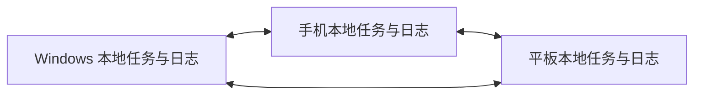

# DeskWeek 三端局域网同步协议设计

日期：2026-11-10。状态：实现前设计基线。P0 互通实验后冻结消息 schema、签名编码与依赖版本；本文不表示功能已经实现。

## 1. 拓扑与标识

Windows、Android 手机和平板为平等副本，均可发起和接受连接，无固定服务器、账号或云中继。各端保存完整任务和已知操作；任意两端同步后，第三端稍后补齐。



| 标识 | 语义 |
| --- | --- |
| protocolVersion | 首版主版本 1；不兼容时拒绝应用并提示升级 |
| groupId | 用户的数据集 UUID，首次组建或加入；一安装首版只激活一个组 |
| actorId | 当前安装身份 UUID，绑定设备公钥；不使用 IP、MAC 或硬件序号 |
| seq | 当前组中本作者的递增序号，与日志可恢复地共同提交 |
| opId | actorId:seq，在 groupId 范围内唯一 |

重装或恢复副本生成新 actorId，不把相同私钥与 seq 状态克隆到另一台设备。旧历史仍保留原始作者。

## 2. 发现、配对与权限

1. 可执行且启用同步的设备发布 `_deskweek-sync._tcp` DNS-SD 服务，端口由系统分配。Android 使用 NsdManager；Windows 实现在 P0 验证。
2. TXT 只含协议版本及最少定位标识，不广播任务、密钥或用户身份。发现结果只是地址候选，不能作为授权。
3. 首次用户启动短时配对窗口；二维码包含邀请 ID、期限、目标证书指纹及随机一次性秘密。邀请限速、单次使用、到期失效。
4. 手动入口使用双方核对的短认证字符串确认完整握手，短码不直接充当加密密钥。扫码或手动配对均确认双方设备身份。
5. 双方保存 groupId 和对端身份。三台设备由向导逐对建立三条信任关系，不只建立两条“连电脑”的关系，此后自动重连。
6. 新设备有旧数据时先预览；相同 taskId 与相同内容判等，内容不同保留差异并走冲突流程，不静默覆盖。
7. mDNS 被阻时允许 IP/端口或二维码直接连接；每次仍验证身份。手动地址不能绕过 AP 隔离或防火墙。

已配对设备进入可互通局域网后自动连接，无须重复确认或输入 IP。局域网可包含电脑有线和移动端 Wi-Fi；不要求互联网连通，不以 Wi-Fi 名称判断可达。

Android 网络权限按 OS/targetSdk 分支处理；当前 targetSdk=36，升级到 37 时纳入 ACCESS_LOCAL_NETWORK。Windows 首次开放监听使用正常的系统防火墙授权流程，不禁用防火墙。

逐对撤销只撤销本机对该身份的连接及新增操作信任，不声称能立即在离线的其他副本上撤销。全组移除向导需逐端处理；已同步的历史不能远程擦除。中转操作的原作者也必须在接收方可信。

## 3. 加密传输与消息

优先采用 Node tls 与 Android SSLSocket/SSLServerSocket。TLS 至少 1.2，双方支持时协商 1.3；双方身份固定到配对结果，不使用“接受所有证书”。证书生成、有效期、更新和 Android 8.0 兼容性在 P0 实测；换身份须旧身份授权或重新配对。

帧为 4 字节无符号大端长度 + UTF-8 JSON。每帧最多 1 MiB，OPS 批次最多 100 条且同时满足帧上限；超限、空帧、非法 JSON、过深结构、未知必需字段拒绝。设置连接超时、并发上限与退避。不接收可执行命令、任意文件路径或文件附件。

| 消息 | 内容与用途 |
| --- | --- |
| HELLO | 版本、groupId、actorId、会话 nonce、能力协商 |
| SUMMARY | 按作者已连续持久化的 seq 向量与缺口 |
| WANT | 请求某作者的区间，分页补齐 |
| OPS | 原始不可变操作，可中转已验签操作 |
| ACK | 已持久化的连续进度，不是网络包收讫 |
| CHANGED | 新操作提示，丢失后由 SUMMARY 补齐 |
| PING/PONG | 仅活跃会话保活 |
| ERROR | 权限、协议版本、组错误、损坏、暂时失败等分类 |

双方同时连接时按 actorId 排序确定保留连接；不能依靠这一优化替代 opId 去重。只使用发现到的局域网接口或明确选择的本地端点，无公网中继、无 UPnP 开端口；多网卡、VPN 和 IPv6 link-local scope 在 P0 覆盖。

## 4. 操作结构与因果关系

以下为语义示例，最终校验和签名测试向量由 P0 固化：

```json
{
  "protocolVersion": 1,
  "groupId": "group-uuid",
  "opId": "actor-uuid:42",
  "actorId": "actor-uuid",
  "seq": 42,
  "context": { "actor-uuid": 41, "other-actor": 8 },
  "taskId": "task-uuid",
  "kind": "patch",
  "changes": { "title": "完成周计划" },
  "recordedAt": "2026-11-10T02:00:00Z",
  "signature": "base64-signature"
}
```

唯一键为 `(groupId, actorId, seq)`；重复接收幂等。同键不同内容视为损坏或身份克隆，停止该作者流，不任意挑一个继续。

操作使用标准 ECDSA P-256/SHA-256 签名。签名覆盖除 signature 外的规范化完整操作，固定 JSON 规范化及 DER/原始签名编码的唯一选择，JS/Kotlin 使用共同测试向量；不自创密码算法。转发保留原始签名和作者。

context 是生成操作时已应用的连续版本向量。收到 seq=42 不代表 1..42 完整；缺少本作者前序或其他依赖则暂存并请求缺口，不能越过缺口推进 ACK。recordedAt 只供记录，data.json revision 只属本端提交；两者均不作为跨端冲突胜负依据。

kind 至少覆盖 create、patch、trash、restore、purge、resolve。create 提供完整初值，patch 只包含实际变化。关联字段按业务组原子合并：

| 组 | 内容 |
| --- | --- |
| 标题 | title |
| 备忘 | detail |
| 日程 | date、time、defer；清除日期时归一化相关值 |
| 完成 | done、completedAt；撤销完成时清空 completedAt |
| 生命周期 | active/trashed/purged、deletedAt |
| 创建信息 | createdAt 由 create 确定，不由普通 patch 改写 |

同日分色作为确定性投影，顺序增加 taskId 稳定决胜，三端从相同集合得到相同颜色。需要调整桌面当前按数组顺序重新分色的行为，建立共同样例；颜色归一化不反复生成用户操作。

未识别业务扩展字段进入兼容存储，往返不丢失；不支持的同步操作类型或必需 schema 拒绝应用并提示升级，不能声称已同步。

## 5. 合并、冲突与删除

- 有因果先后：新操作替代它已观察的旧字段组值。
- 并发改不同字段组：合并两者，例如标题与日期均保留。
- 同组并发同值：合并候选来源，不产生重复任务。
- 同组并发不同值：保留多值候选和来源，创建冲突记录；临时显示值用 `(seq, actorId)` 固定排序选出，但不称为真实最新，不丢弃其他候选。
- 用户解决冲突产生 resolve 操作，context 包含展示过的候选；未见过的第三端操作仍可能产生新冲突。
- trash 与编辑并发：任务留在垃圾箱，编辑保留以供恢复；编辑不能隐式恢复。
- trash 与 restore 并发：trash 优先；观察到 trash 后产生的 restore 才明确恢复。
- purge 终结该 taskId；后续/旧设备编辑不复活，同 ID create 拒绝。重新创建必须新 ID。

永久删除保留最小墓碑及必要历史。首版不按固定天数清理日志或墓碑；压缩需要单独设计快照代际、离线成员重入和确认机制。

接收中转操作时验证原作者可信、签名、groupId、schema 与约束；验签失败不能因转发方可信而放行。同一操作不能改作者或换新 seq，防止环状转发产生回声。

## 6. 持久化与 Windows 接入

Android 用 Room 事务原子提交任务投影、冲突、墓碑、操作、seq 和已应用向量。成功后才 ACK、通知界面并刷新组件。

Windows data.json 保留为业务兼容投影，增加可恢复日志和检查点；两个文件不能共同原子替换，不能简单“写 JSON 再补日志”。

1. 所有本机窗口、导入和远端写入进入同一个主进程串行提交入口。
2. 本机改动先按现有 base/next/current 合并校验，计算真实差异；之后产生带作者序号的操作。
3. 写入含校验的提交记录并 fsync，记录包含恢复投影所需信息；日志成功是提交点。
4. 已提交历史产生 data.json 投影，沿用原子替换与有效备份；日志未提交不广播、不 ACK。
5. 日志已提交但投影写失败，阻止后续不安全写入并进入恢复状态。反馈“已记录，待恢复”，不能回退 seq 后重用；重启重放日志完成投影。
6. 检查点原子保存日志位置和向量；仅能截断经校验确认未提交的末尾残片，中部损坏停止并提示恢复。

启动恢复日志和检查点，不能仅相信旧缓存。同步状态备份和 data.json 恢复必须一致，禁止恢复旧投影却保留较新 ACK。具体日志封装在 P0 原型验证，在 P2 做各崩溃点测试。

接入点：src/main/index.cjs 生命周期，src/main/storage/store.cjs 提交，src/main/ipc/index.cjs 状态/设置，src/preload/index.cjs 白名单接口。网络不直接写文件、渲染器不监听网络。远端应用后复用 store-changed 广播，同时保留来源避免重复生操作。

首次迁移备份现有数据并生成 create 历史；同 ID 同内容判等，不把已有三份同一 data.json 变三份新任务。同 ID 不同内容需预览并保留差异。

旧程序或手改文件造成投影与日志不一致时检测并要求显式导入，不静默覆盖日志，也不把无法解释的差异自动传播全网。

## 7. 调度与用户状态

显示未启用、未配对、发现中、连接、同步中、已同步、等待设备上线、后台等待执行、权限拒绝、冲突、失败重试；包含最后成功时间和待发送数量。

“已同步”限定到已确认的具体对端向量，第三台离线时不能声称全组三端完成。各端最终一致包括任务、墓碑、候选冲突和确定性投影。

Android 前台保持发现与会话，退出前台释放不必要监听。Worker 在获准执行时短期注册、发现、主动连接并接受连接，结束释放；两个休眠移动端的 Worker 窗口不保证重合。可靠即时手机↔平板验收在双方前台或主动限时同步会话中完成。

用户主动限时会话可使用 dataSync 前台服务和通知，处理系统超时，不按无限常驻设计。普通后台、Doze 或强行停止后不承诺秒级更新；恢复执行后补齐。网络变更释放旧连接/发现状态，新网络重试并指数退避加抖动。

组件操作先本地事务，后短时同步；执行配额不足排队，不阻塞本地勾选。组件长期显示不代表 App 进程可被远端随时访问。

## 8. 交换格式、备份与数据集

data.json 只交换业务内容，保留兼容字段和未知 prefs，不含私钥/配对凭据，不是完整同步备份。revision 不跨端排序；设备外观与 AI 配置不进入同步。

在当前组中合并/覆盖导入均先预览与备份，再生成普通操作。覆盖导致缺失任务时生成删除/清除操作，提示传播范围；不能清空表和游标绕过墓碑。

新建独立数据集使用新 groupId 并重新配对，旧组操作禁止跨组应用。完整备份用单独版本化格式，含历史、冲突、墓碑及校验，默认排除凭据；恢复生成新身份。原作者验签公钥可随历史保留，但不能因此自动信任其发送新操作。

## 9. 必测契约

| 场景 | 结果 |
| --- | --- |
| 三端离线各自新增 | 联网后并集，无重复 |
| 同任务不同字段 | 合并收敛 |
| 同字段并发 | 候选不丢，三端可见、可解决 |
| 修改与 trash/restore/purge 并发 | 生命周期规则一致，purge 后不复活 |
| 长期离线设备回归 | 墓碑仍有效，补齐历史 |
| 乱序、重复、丢 ACK、环状转发 | 幂等、补缺口、不回声、不提前确认 |
| 各提交点崩溃/磁盘写失败 | 不丢已提交操作，不回退 seq |
| 时钟相差一天 | 不靠墙钟覆盖，因果正确 |
| 电脑关闭 | 两 Android 双向发起/接受连接并同步 |
| 无互联网 Wi-Fi、电脑有线 | 可互通时正常同步 |
| AP 隔离、禁组播、阻端口 | 诊断可解释，不声称手动地址能绕过隔离 |
| 假证书、未配对作者、伪造中转 | 不读取或应用任务，不记录敏感载荷 |
| 版本不兼容、超大包、非法数据 | 拒绝输入，现有数据有效 |
| 覆盖导入后旧设备重连 | 正常传播删除，不复活任务 |
| 前台/后台/Doze/强停 | 分别验证即时、延迟及待恢复状态 |

P0 固化平台互通记录和跨语言消息样例；P2 验证正确性后，P3 才把自动发现与调度开放为日常功能。平台限制的官方依据见 [实现规划](android-port-plan.md#9-官方依据)。

## 10. P0 落地记录（2026-11-10）

已冻结，两端各有实现与测试：

| 项 | 决定 | JS | Kotlin |
| --- | --- | --- | --- |
| 规范化 JSON | 键按 UTF-16 码元升序；仅安全整数；只转义 `"` `\` 与 C0；拒绝未配对代理项 | `src/main/sync/canonical.cjs` | `core/sync/CanonicalJson.kt` |
| 帧 | 4 字节无符号大端长度 + UTF-8 JSON，单帧 ≤ 1 MiB | `frame.cjs` | `FrameCodec.kt` |
| 消息集 | HELLO/SUMMARY/WANT/OPS/ACK/CHANGED/PING/PONG/ERROR，`protocolVersion = 1` | `messages.cjs` | `SyncMessages.kt` |
| 测试向量 | 11 条（中文、emoji、控制字符、边界整数、同步消息样例），两端必须逐字节一致 | `test/fixtures/sync-vectors.json` | 同名资源 |
| 传输 | TLS ≥ 1.2（实测协商 1.3），自签测试证书按 SHA-256 固定指纹，禁止「接受所有证书」 | `p0-server.cjs` | `SyncClient.kt` |

**未冻结 / 未实现**：操作签名的编码细节（ECDSA P-256 与规范化的组合方式）、配对二维码与短认证码、
mDNS 发现、操作合并与冲突记录、墓碑与 purge、seq 的持久化与崩溃恢复、后台与 Doze 调度。

`test/fixtures/certs/` 下的私钥仅用于原型，不得用于任何正式环境。

复现互通：

```bash
# 宿主机（deepweek-andriod）
node scripts/serve-p0.cjs 47821
# 模拟器内：DeskWeek → 设置 → P0 互通自检
```
