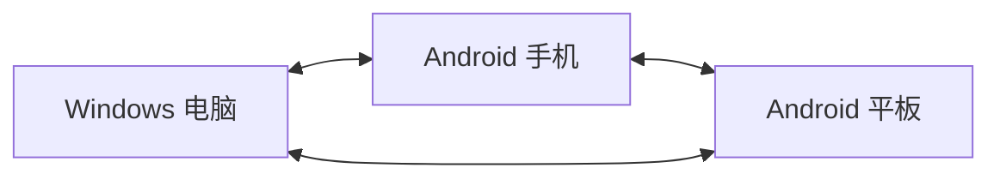
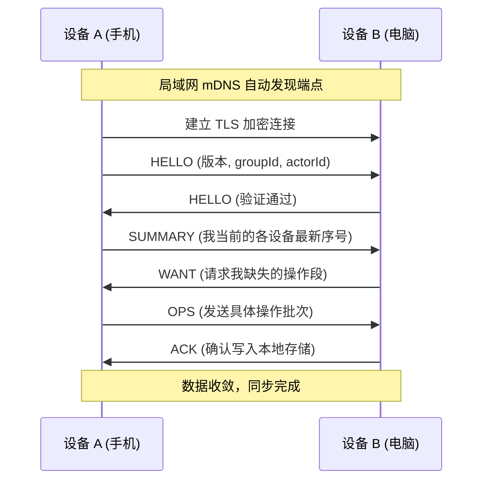

# DeskWeek 局域网多设备协同同步协议设计

本文档介绍了 DeskWeek 在 Windows 电脑、Android 手机与平板之间实现多端局域网同步的底层协议设计。

---

## 一、设计目标与核心原则

1. **去中心化与平等对等**：没有中心云端服务器，Windows 电脑、手机与平板彼此平等，任何两台设备在局域网内均可直接双向通信并同步数据。电脑关机时，手机和平板仍能互相同步。
2. **离线优先（Local-First）**：所有任务操作首先写入设备本地，无论设备是否处于联网状态，用户均可顺畅使用全部功能。重新连接局域网后，系统自动在后台完成增量补齐。
3. **端到端加密与安全验证**：通信全程使用 TLS 加密通道，首次配对时双方核验并固定身份凭证，陌生设备即使在同一 Wi-Fi 下也无法偷窥或篡改任务内容。
4. **确定性合并与冲突保护**：并发编辑时遵循明确的因果合并规则，自动合并不同属性的修改；遇到相同文字内容的直接冲突时保留双方内容，绝不静默丢失用户数据。



---

## 二、设备发现与安全配对

### 1. 局域网服务发现（mDNS / DNS-SD）
- 运行中且开启同步的设备会在局域网内通过标准 mDNS 广播服务：
  - **服务类型**：`_deskweek-sync._tcp`
  - **服务端口**：系统动态分配的安全端口
  - **广播信息**：仅包含协议主版本号与数据集标识（groupId），不包含任何待办内容或个人隐私。

### 2. 首次配对机制
- 当新设备初次加入现有设备群时，通过一次性安全配对完成身份认证：
  - **配对向导**：支持屏幕扫码或输入简短安全确认码。
  - **身份固定**：双方在首次配对时交换公钥证书指纹并保存在本地信任列表中。
  - **信任建立**：配对成功后，设备在后续日常使用中即可自动识别对方，无需每次重复输入 IP 或确认。

---

## 三、加密传输与会话流程

### 1. 传输层安全（TLS）
- 所有网络传输均在 TLS 1.2 / TLS 1.3 加密层之上进行。
- 连接建立时严格校验对端证书是否与配对时记录的证书指纹一致，有效防御局域网内的中间人监听。

### 2. 数据帧格式
通信采用轻量、可靠的流式帧协议：
- **前 4 字节**：大端无符号整数，表示后续消息体的字节长度。
- **消息体**：UTF-8 编码的 JSON 数据包，单帧最大限制为 1 MiB。

### 3. 会话消息类型与交互链路

| 消息类型 | 作用说明 |
| --- | --- |
| `HELLO` | 握手消息，交换协议版本、数据集标识（groupId）及设备身份（actorId）。 |
| `SUMMARY` | 向量摘要，告知对方本地当前已记录的各设备操作最新序号（seq）。 |
| `WANT` | 请求缺失的操作区间，支持分页传输，避免突发大包。 |
| `OPS` | 传输具体的操作日志批次，包含每条操作的详细改动与作者签名。 |
| `ACK` | 确认收讫并已安全落盘的操作序号。 |
| `PING / PONG` | 活跃连接的心跳保活与连通性检测。 |

**典型同步交互时序：**



---

## 四、增量操作与冲突合并规则

### 1. 操作（Op）结构设计
每个任务的新增、修改或删除都会生成一条不可变的原子操作记录：

```json
{
  "protocolVersion": 1,
  "groupId": "group-uuid",
  "opId": "actor-uuid:42",
  "actorId": "actor-uuid",
  "seq": 42,
  "taskId": "task-uuid",
  "kind": "patch",
  "changes": {
    "title": "整理本周工作周报",
    "done": true
  },
  "recordedAt": "2026-11-10T12:00:00Z",
  "signature": "base64-signature"
}
```

- **opId**：由设备身份 `actorId` 和递增序号 `seq` 组成，在全局唯一。
- **signature**：使用生成该操作的设备私钥签名，接收方验签通过后才予接收，防止恶意篡改。

### 2. 冲突解决策略
- **不同字段并发修改**：例如在电脑上修改了任务标题，在手机上把该任务打勾完成，两端同步后会自动合并两项改动，既保留新标题，也保留完成状态。
- **同字段直接冲突**：如果在两台设备离线状态下同时修改了同一个字段（例如两边修改成了不同的标题），系统会保留双方的修改内容作为候选版本，并在界面上友好提示用户选择保留哪一份，避免信息丢失。
- **删除与恢复保护**：删除操作作为墓碑标记记录在历史中，确保离线设备重新上线时不会误将已删除的任务“复活”。

---

## 五、业务与本地状态隔离

同步协议严格区分**公共业务数据**与**设备独立状态**：

- **参与同步的内容**：待办事项（标题、备忘、所属日期、时间、提前提醒规则、完成状态）、废纸篓状态与操作历史。
- **保持本机独立的内容**：
  - 窗口位置、尺寸与屏幕排列（各设备屏幕大小不同，独立记忆）。
  - 桌面浮窗/小组件的背景透明度、明暗文字模式。
  - AI 助手接口配置与本地加密存储的 API Key（保障凭证安全不外流）。
