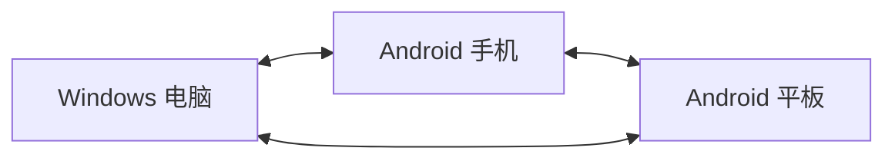

# DeskWeek 三端局域网同步协议

> 2026-11-10：跨端方案已改为 [二维码与文件离线传输](offline-json-qr.md)。下面的局域网协议是历史设计，暂未实现。

## 1. 整体结构

三台设备（Windows 电脑、Android 手机、Android 平板）各自保存完整任务数据，地位平等，任何两台都能互相发起和接收连接。没有固定的服务器、账号或云中转。任意两端同步后，第三端稍后也能补齐。

每台设备有一个唯一身份标识（actorId），和一个递增的操作序号（seq）。不使用 IP 地址或硬件序列号来标识设备。

## 2. 配对与发现

1. 设备在局域网里广播一个"我是 DeskWeek"的信号（通过 DNS-SD），其他设备可以自动发现
2. 第一次配对需要人工确认：扫二维码或者核对双方显示的数字
3. 配对完成后保存对方身份，之后自动连接，不用再输入 IP
4. 没有配对过的设备看不到你的任务
5. 手动填 IP 也可以连接，但每次仍然会验证身份
6. 移除设备信任后，对方就连不上了

## 3. 加密传输

所有通信使用 TLS 加密（至少 1.2 版本），双方身份绑定到配对时的证书。不会"接受所有证书"。

通信格式：每条消息前面有 4 字节的长度头，后面是 UTF-8 编码的 JSON。

常用的消息类型：

| 消息 | 用途 |
| --- | --- |
| HELLO | 打招呼：告诉对方版本号和身份 |
| SUMMARY | 告诉对方"我已经有哪些操作了" |
| WANT | 请求对方发送缺少的操作 |
| OPS | 发送操作记录 |
| ACK | 确认已经保存好了 |
| CHANGED | 提醒对方有新操作 |
| PING/PONG | 保持连接活跃 |
| ERROR | 报告错误 |

## 4. 操作记录

每一次修改任务（新建、改标题、完成、删除等）都会生成一条操作记录，包含：

- 谁做的（actorId）
- 第几个操作（seq，递增）
- 改了什么（比如 `title: "完成周计划"`）
- 当时已经看到了对方的哪些操作（用于判断先后关系）
- 操作者的数字签名（防篡改）

同一条操作重复收到会自动忽略，不会产生重复任务。

## 5. 合并规则

- **有明确先后的**：后面的修改覆盖前面的
- **同时改了不同内容**（比如一边改标题一边改日期）：两个都保留
- **同时改了同一个字段**：保留两个候选值，让你在界面上选择
- **一边删了一边改了**：任务留在垃圾箱，改的内容保留，恢复后还能看到
- **永久删除**：彻底删掉，其他设备的旧数据也不会让它复活

## 6. 数据存储

Android 使用 Room 数据库，保证操作日志和任务数据一起保存成功，不会出现"保存了一半"的情况。

Windows 的 data.json 保留为兼容格式，同时增加操作日志：
1. 所有修改都经过同一个入口，先保存操作日志，再更新 data.json
2. 如果日志保存成功但 data.json 没写好，重启后会自动修复
3. 不会因为写失败就丢掉已经保存的操作

## 7. 备份与导入导出

- data.json 只包含任务数据，不包含密钥或配对信息
- 合并导入：先预览变化，确认后导入
- 覆盖导入：先备份，然后完全替换
- 完整备份另有专门格式，包含操作历史
- 恢复安装会生成新身份，需要重新配对

## 8. 必须测试通过的场景

| 场景 | 正确结果 |
| --- | --- |
| 三端各自离线新建任务 | 联网后全部汇合，没有重复 |
| 同一任务改了不同字段 | 合并后都保留 |
| 同一字段被两端同时改了 | 两个候选都显示，三端都能看到并选择 |
| 修改和删除同时发生 | 生命周期规则一致，永久删除后不复活 |
| 长时间离线的设备重新上线 | 历史记录和删除标记都还在，正常补齐 |
| 乱序、重复、丢失确认 | 自动去重、补缺口，不产生错误数据 |
| 保存过程中崩溃 | 已保存的操作不丢失 |
| 电脑关了 | 手机和平板仍能互相同步 |
| 没有外网的 Wi-Fi | 只要两端能互相访问就能同步 |
| 冒充身份或伪造数据 | 拒绝接收，不会泄露任务内容 |

## 9. 当前进展（2026-11-10）

已经完成的部分：

| 项目 | 说明 |
| --- | --- |
| JSON 格式统一 | 两端按相同规则排列键值，11 条测试样例逐字节一致 |
| 加密通信 | TLS 1.2+，自签证书按指纹校验 |
| 操作签名 | ECDSA P-256 + SHA-256，两端交叉验证 |
| 操作日志 | 去重、缓冲乱序、补缺口 |
| 合并算法 | 不同字段自动合并、删除优先、永久删除终结 |

**还没做的**：配对二维码、mDNS 自动发现、操作日志持久化、合并与冲突记录界面、后台调度等。

> 测试目录下的证书仅供开发测试使用，不可用于正式环境。
